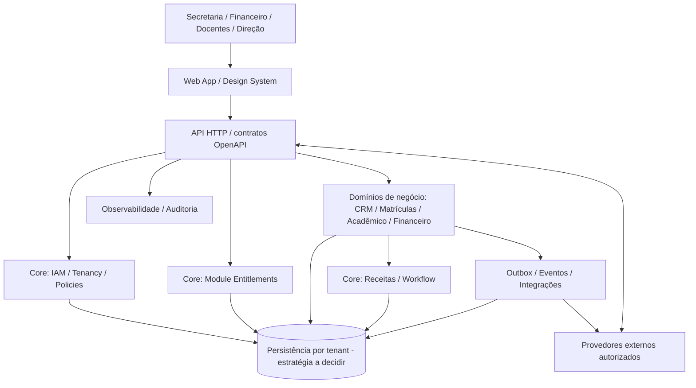

# ARCHITECTURE.md — Contrato arquitetural da plataforma ERP

> **Versão:** 0.1 · **Status:** DRAFT / proposta não aprovada · **Owner:** arquitetura + responsável humano pelo produto  
> **Natureza:** documento de orientação dos agentes; não representa software implementado.  
> **Primeira vertical:** Educação · **Visão de longo prazo:** ERP SaaS modular multissetorial.

## 1. Objetivo e fontes de verdade

Arquitetar uma plataforma de gestão confiável, extensível e auditável, começando pela operação de uma escola sem incorporar conceitos escolares ao núcleo genérico. A F10/Hermes podem fornecer **referências funcionais observadas com autorização**, nunca código-fonte proprietário, identidade visual, textos exclusivos, credenciais ou implementações copiadas.

**Precedência em caso de conflito:** instrução explícita e autorizada do humano → controles de segurança e governança → ADR **APPROVED** e specs **APPROVED** → este documento → detalhes das propostas em `docs/ARCHITECTURE/` → hipóteses ou observações de pesquisa. Não tratar um documento **DRAFT** como decisão irrevogável. Divergências devem ser registradas em `state/OPEN_QUESTIONS.md` ou resolvidas via ADR; nenhuma decisão de risco alto pode ser autoaprovada pelo agente.

Documentos detalhados: [estratégia](docs/ARCHITECTURE/PLATFORM_STRATEGY.md), [arquitetura-alvo](docs/ARCHITECTURE/TARGET_ARCHITECTURE.md), [mapa de domínio](docs/ARCHITECTURE/DOMAIN_MAP.md), [contratos API](docs/ARCHITECTURE/API_CONVENTIONS.md), [integrações e eventos](docs/ARCHITECTURE/EVENTS_AND_WORKFLOWS.md), [módulos](docs/ARCHITECTURE/MODULE_SDK.md), [dados](docs/ARCHITECTURE/DATA_AND_MIGRATION.md) e [ADRs pendentes](docs/ARCHITECTURE/DECISIONS_TO_MAKE.md).

## 2. Atributos de qualidade (ordem de prioridade)

1. **Integridade e isolamento de dados:** uma instituição nunca consegue ler ou alterar informações de outra, inclusive por jobs, relatórios, exports e integrações.
2. **Correção de regras críticas:** financeira, matrícula, contratos e autorização com invariantes, rastreabilidade e capacidade de reconciliação.
3. **Segurança e privacidade:** mínimo privilégio, dados de estudantes protegidos, LGPD desde a concepção.
4. **Evolução sem regressão:** boundaries verificáveis, contratos versionados, testes e migrations seguros.
5. **Operabilidade e disponibilidade:** logs correlacionáveis sem PII, métricas, alertas, backup e recuperação comprovados.
6. **Usabilidade e desempenho:** jornadas rápidas, acessíveis e compreensíveis por função.
7. **Extensibilidade de negócio:** novos módulos e verticais sem acoplamento transversal indevido.

SLOs, metas de latência, capacidade e RPO/RTO **não estão definidos**. Propor valores somente após contexto do piloto, perfil de carga e orçamento; registrar em `docs/OPERATIONS/OBSERVABILITY_AND_SLO.md` e ADR.

## 3. Arquitetura lógica proposta (C4 simplificado)



**Importante:** o desenho descreve responsabilidades, não necessariamente processos, servidores ou serviços independentes. A estratégia inicial recomendada é **monólito modular**, condicionada à aprovação de `docs/ARCHITECTURE/ADR/ADR-0001-PLATFORM.md` (atualmente **PROPOSED**).

### 3.1 Núcleo horizontal (`core/`)

- Organizações, tenants, unidades, usuários, identidades, sessões e permissões.
- Catálogo e habilitação de módulos por tenant, sem substituir autorização por usuário/recurso.
- Auditoria, notificações, armazenamento, interfaces de integração e orquestração de tarefas.
- Observabilidade, catálogo de eventos, versionamento de contratos e operações internas.
- **Separação inequívoca:** faturamento da **assinatura SaaS** não é a mesma coisa que o **contas a receber de uma escola**.

### 3.2 Primeira vertical (`verticals/education/`)

- Pessoas e papéis escolares: aluno, responsável, docente, atendente, direção.
- CRM / funil de captação e comunicação.
- Matrículas, turmas, calendário, frequência, notas e documentos (conforme escopo aprovado).
- Contratos e financeiro da instituição com reconciliação, histórico e controles.

### 3.3 Futuras verticais

- Serviços e comércio são hipóteses comerciais, **não escopo comprometido do MVP**.
- `core` não importa dependências de `education`; a vertical consome portas e contratos públicos do core.
- Reuso entre setores exige **segunda implementação real** ou validação por ADR, e não abstrações especulativas.

## 4. Contratos entre módulos e regras de dependência

1. Cada domínio é dono de suas regras e persistência. Outro módulo não escreve suas tabelas privadas nem depende de estruturas internas.
2. Interação síncrona por portas/use cases/serviços de aplicação com interfaces tipadas e validação de entrada/saída.
3. Interação assíncrona por eventos versionados, handlers idempotentes e **outbox transacional** para comunicação confiável com externos.
4. Contratos públicos: OpenAPI como fonte do cliente Orval, JSON Schema/event schemas onde aplicável; código gerado não é editado manualmente.
5. Dependência entre domínios deve apontar para contratos expostos, e ciclos de dependência devem falhar em testes de arquitetura.
6. Módulo desabilitado não pode ser acessado pela API mesmo que a rota exista; autorização por recurso continua independente do entitlement.

**Exemplo de contrato (ilustrativo, não aprovado):**

```text
Education.EnrollStudent(command, actorContext, tenantContext)
  -> EnrollmentCreated | ValidationError | Forbidden | Conflict
  -> publica EnrollmentCreated.v1 APÓS persistência confirmada
  -> Finance recebe evento sem acessar tabelas internas de Education
```

## 5. Invariantes de dados e de segurança

| Invariante | Obrigação de projeto | Evidência mínima |
|---|---|---|
| Isolamento multi-tenant | Contexto de tenant deriva da autenticação/autorização, validado em consultas e mutações | Testes adversariais cross-tenant em API, jobs e relatórios |
| Autorização | Checagem server-side por ator/ação/recurso/contexto | Matriz RBAC/ABAC e testes negativos |
| Financeiro | Transações consistentes, idempotência em efeitos externos, trilha de compensação/estorno | Testes de retry, concorrência, falhas parciais e reconciliação |
| Auditoria | Quem, o quê, quando, tenant e correlação sem vazamento desnecessário de PII | Testes de imutabilidade e controle de acesso |
| Dados pessoais | Minimização, retenção, finalidade, direitos e controles LGPD | Mapa de dados + revisão de segurança e privacidade |
| Migrações | Expand → migrate → contract, testes de compatibilidade e ensaio de restauração | Plano testado e evidência de rollback/roll-forward |
| Eventos | Delivery at-least-once não pode duplicar efeitos de negócio | Testes de replay e deduplicação |

**Autorização e cobrança reais, migrações destrutivas ou produção:** exigem aprovação humana. Referências: [ameaças](docs/SECURITY/THREAT_MODEL.md), [controles financeiros](docs/SECURITY/FINANCE_CONTROLS.md), [dados/LGPD](docs/SECURITY/LGPD_DATA_MAP.md) e [autonomia](docs/GOVERNANCE/AUTONOMY_POLICY.md).

## 6. Estrutura de repositório alvo (proposta, não scaffolding existente)

```text
apps/
  web/                    # shell, telas e integração com API
  api/                    # aplicação HTTP, authn/authz, composição
packages/
  ui/                     # design system + Storybook
  tokens/                 # tokens de tema e tipografia
  contracts/              # OpenAPI, schemas, eventos versionados
  core/                   # tenancy, políticas, auditoria, workflows
  education/              # bounded contexts da vertical inicial
  testing/                # helpers e fixtures sintéticas
infra/                    # IaC e observabilidade após ADR
specs/                    # specs e cenários de aceite
```

A estrutura, a stack e as convenções tornam-se vinculantes **somente após ADR e spec aprovados**. Ver decisões pendentes em `docs/ARCHITECTURE/DECISIONS_TO_MAKE.md`. Stack candidata: TypeScript, React, API Node.js, PostgreSQL, OpenAPI/Orval, Storybook, Vitest e Playwright. ORM, framework da API, autenticação, modelo de banco/tenant, infraestrutura e event broker continuam em aberto.

## 7. Deploy, dados e operações

- Ambientes separados por finalidade, credenciais distintas; dados sintéticos fora da produção.
- Migrations e seed determinísticos, sem dados pessoais reais em PRs e pipelines.
- Correlation IDs em requisições/jobs, logs estruturados com redaction, métricas por jornada e tracing nos limites entre módulos.
- Segurança de supply chain: lockfiles, revisão de licenças/dependências, varredura de secrets/SCA e base images atualizadas.
- Recuperação: backup, simulação de restore, DR, rotação de segredos e runbooks antes de atender clientes reais.
- Não inventar throughput, escalabilidade ou certificações; medir no ambiente representativo.

## 8. Arquitetura orientada a testes

**Antes de desenvolver:** spec `APPROVED` + contrato + ADR quando necessário. **Durante:** TDD RED → GREEN → REFACTOR e testes de integração. **Depois:** contratos, E2E P0, regressão visual, acessibilidade, segurança e performance mensurável.

- Cobertura obrigatória em domínios críticos: **100% statements, branches, functions e lines**, comprovada no CI. Cobertura elevada é **necessária, mas não suficiente**.
- Mutação/property-based tests para invariantes críticos; teste arquitetural bloqueia imports ilegais e dependências cíclicas.
- E2E cross-tenant, permissão negada, idempotência, concorrência, falha parcial, retry e recuperação são obrigatórios nos fluxos correspondentes.
- Contratos OpenAPI versionados; mudanças incompatíveis precisam de migração de consumidores.
- Nunca marcar uma verificação como PASS sem executá-la. Sem app construída, registrar `NOT RUN`.

Referências: [gates 100%](docs/GOVERNANCE/QUALITY_GATES_100.md), [estratégia de testes](docs/TESTING/TEST_STRATEGY.md), [regressões](docs/TESTING/REGRESSION_MATRIX.md), [CI](docs/OPERATIONS/CI_CD.md).

## 9. Processo obrigatório para alterações arquiteturais

1. Identificar boundary, fluxos, dados e riscos afetados.
2. Propor ao menos duas opções com trade-offs de segurança, custo, latência e reversibilidade.
3. Registrar RFC/ADR com estado `PROPOSED`; buscar revisão e aprovação necessária.
4. Atualizar specs, contratos, desenho C4, mapa de dependências e testes arquiteturais.
5. Executar gates e registrar evidência. Atualizar este resumo após a aprovação.

**Anti-patterns vetados:** microserviços por moda; import de domínio escolar pelo core; autorização somente no frontend; dados cross-tenant sem filtro; estado financeiro mutável sem trilha; UI como fonte de entitlement; acoplamento de clientes ao banco; eventos sem idempotência; usar recursos de terceiros como documentação executável.

## 10. Definition of Architecture Ready

- [ ] Contexto de negócio e bounded context claros.
- [ ] ADRs relevantes aprovados por responsável definido.
- [ ] Contratos API/eventos e ownership de dados definidos.
- [ ] Tenant/identidade/autorização tratados explicitamente.
- [ ] Modos de falha, recuperabilidade, threat model e observabilidade descritos.
- [ ] Testes necessários e impactos de migração registrados na spec.
- [ ] Trade-offs documentados e links atualizados.

**Status atual:** direcionamento arquitetural **proposto**, decisão final e implementação **pendentes**.
